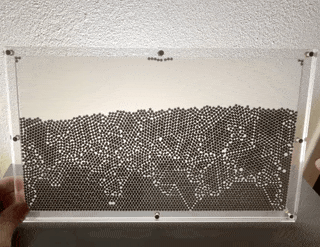
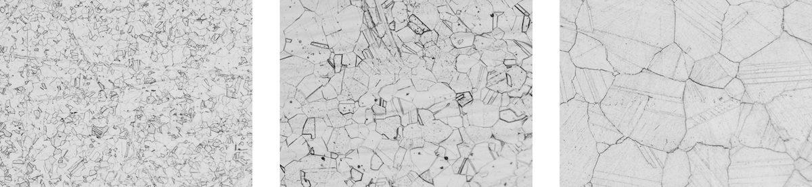
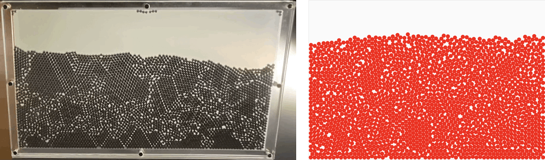
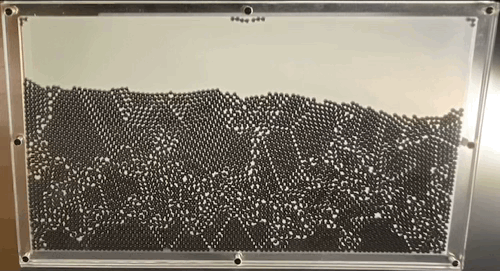
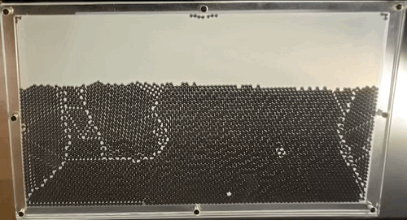
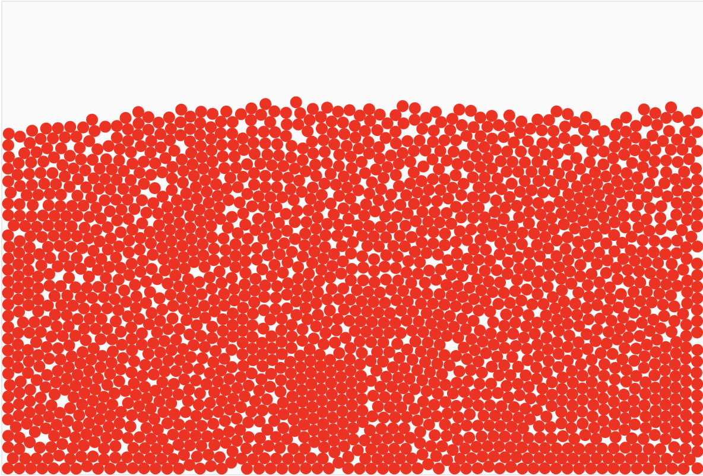
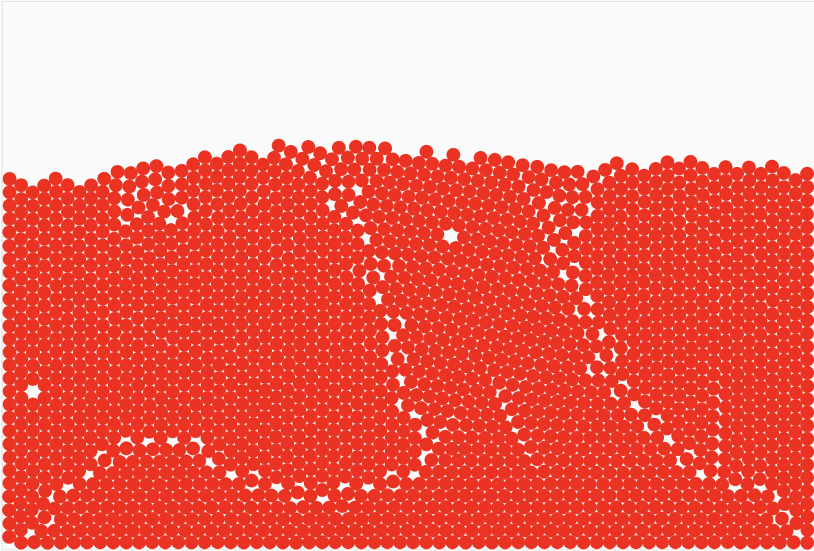

  

# Introduction
---

In the world of metallurgy, the characteristics of steel can be significantly influenced by the processes it undergoes during and after its production. One such process is annealing, which plays a pivotal role in determining the grain density within steel. A project I worked on,<a href="/RobustFeatureAustenit"> linked here</a>, focused on estimating this grain density of steel from microscopy images. Similar alloys can look vastly different based on their annealing duration.

 
Annealing is essentially a heat treatment process where steel is heated to a high temperature and then cooled slowly. This method is crucial because it affects the microstructure and, thus, the physical properties of the steel. The primary reason for annealing steel is to soften it, relieve internal stresses, and improve its ductility and toughness.

To understand this better, consider the process of quick quenching, which rapidly cools the steel. This method tends to “freeze” the chaotic structures within the metal, trapping various forms of imperfections. On the other hand, slowly reheating and annealing the steel allows the atoms—modeled as spheres in this scenario—to gain enough energy to move and settle into their lowest energy state. This state often resembles a well-organized grid of spheres.

# Simulating Dense Packing in 2D
---

I built a small simulation of the packing problem with spheres.
It covers the essential parts that are needed to show how artifacts are introduced during the chaotic settling of the spheres in a non-expanding container are. The simulation, written in <a href='https://brm.io/matter-js/'>Matter.js</a>, adheres to friction, interaction of different masses, and rolling. One thing to note is that I've chosen rather small simulation timesteps, as otherwise the whole system becomes unstable.

Anyway, you should give it a try, and jiggle the particles once they have settled.
You will observe that the initial formation and settling results in rather small coherent patches, the grains in the example of steel plasticity.

    

        

            <canvas id="simulation" style="position: absolute; top: 0; left: 0; width: 100%; height: 100%;"></canvas>
        

    

 

<button id="jiggleSmallButton">Small Jiggle</button>
<button id="jiggleMediumButton">Medium Jiggle</button>
<button id="jiggleLargeButton">Earthquake Jiggle</button>

 
Compare the results that you get with and without annealing, i.e. only earthquake jiggle vs. earthquake jiggle and then repeatedly, while the balls are still settling, small and medium jiggles, simulating a steady stream of kinetic energy, allowing the particles to find their ground state.

# Qualitative Comparison
---

This simulation also matches qualitative results that are observed using my little toy model.
In the physical model the annealing is simulated by tapping on the glass itself.

These gifs show the qualitative similarities between the real world model, and the simulation.

 

The first and the last frame of the animation above are shown now, so that it easier to see the emerging structural similarities.

<table>
    <tr style="background-color: white;">
    <td></td>
    <td></td>
    </tr>
    <tr style="background-color: white;">
    <td></td>
    <td></td>
    </tr>
  <tr style="background-color: white;">
    <td style="text-align:center;"><b>Not Annealed</b> </td>
    <td style="text-align:center;"><b>Annealed </b></td>
  </tr>
</table>

# Remarks on building your own
---
If you wish to build your own model there's a few things you could take away without having to make the same mistakes as I did.
The steel bearings that I bought are 2mm in diameter, and are made of steel. When you invariably drop a 2kg bag of it on the floor, resist the urge to use a magnet to gather them. Magnetization is a real concern, especially once you put them between an isolating material such as plastic glass.

While on the topic of glass: definitely use acrylic glass, and not polycarbonate. While polycarbonate is much cheaper it also discolors and scratches much easier. Additionally bending polycarbonate by applying heat is more difficult. Get acrylic, it is amazing; the steel bearings do not scratch it, it can be broken very cleanly, and can be burnished with a handheld torch at the edges along which it was broken. 
Acrylic glass is manufactured using an extrusion or casting process, and the price between the two varies drastically. I have not found any significant differences between the two for this type of project.

It is important that the steel balls are essentially only allowed to move in 2D.
If they can stack, even slightly, behind each other you will run into a lot of issues such as the glass bending outwards, and potentially breaking.
For my model I used 3mm thick acrylic glass for the front and backplate, and 2mm acrylic glass that was cut to form the frame that is sandwiched between the 3mm plates.
The ballbearing are 2mm and the frame-plate is 2mm. To reduce the scarping, I placed washers that I cut from regular PET bottle plastic between the bolts that hold everything together.

Weight plays a significant role in the design: I initially constructed a larger model weighing about 4 kilograms. Although this model produced more attractive patterns, it proved to be impractical. You cannot simply tip it because the weight of the balls causes the polycarbonate glass to bulge. This deformation allows the spheres to stack in 3D. To prevent this, you would need to use much thicker acrylic glass, which is difficult to break or cut without specialized tools like a laser cutter.

<video autoplay loop muted playsinline  width="80%" style='border: 1px solid black'> <source  src="../misc/densepacking/large.mp4" type="video/mp4"> </video>

 
Regarding the bolts: It is important that the clamping force of the plates is distributed evenly. In general this means more bolts = less pressure on a single spot = better. You can see the effects of the clamping around the bolts where individual balls sometimes get stuck, as the bolt is squeezing the acrylic *just* a little too tight and reduces the tolerances enough for it to be an issue.

To properly see the formation of the grains, I added a frosted acrylic film on the backplate that diffuses light. The dispersion in combination with a flashlight that is placed behind the prop, reveals the created structures really well.

If you make your own, let me know 
I'd be very happy to see your designs.

# Further Reading
---

* Interestingly, around the same time I was building my physical model, popular YouTuber Steve Mould released a video,<a href="https://www.youtube.com/watch?v=xuL2yT-B2TM"> linked here</a>, discussing the same topic.
* <a href="https://en.wikipedia.org/wiki/Circle_packing">Wikipedia Circle Packing</a>
* <a href="https://www.gorillasun.de/blog/a-simple-solution-for-shape-packing-in-2d/">Generative Art with Circle Packing</a>
* <a href="http://datagenetics.com/blog/june32014/index.html">Optimal Packing in 2D, and 3D</a>


  


<script src="../misc/densepacking/densepacking.js">