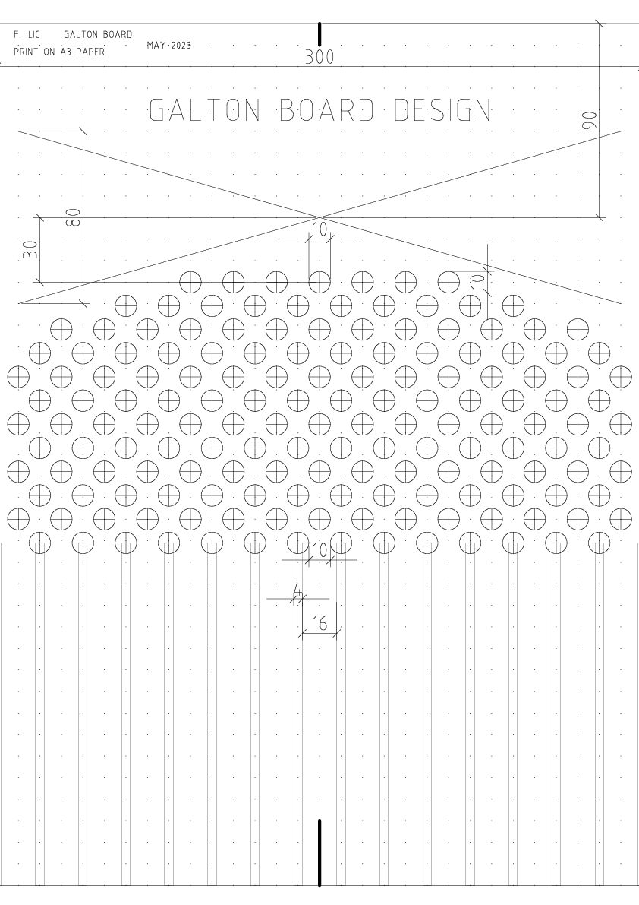

<video autoplay loop muted playsinline  width="80%" style='border: 1px solid black'> <source  src="../misc/galtonboard/galton.mp4" type="video/mp4"> </video>

 
I built this Galton Board from a picture frame, some wood for the funnel, round stock for the pegs, and a bunch of steel ball bearings. The glass is held in with silicone caulk and the pressure of all the wooden elements. A thick MDF board is screwed into the frame from the back, giving it structural stability. It is about $$\frac{1}{2}$$meter tall, and weighs in at around 4kg.

# What is a Galton Board?
---

A Galton Board is a vertical board with a series of pegs arranged in a lattice. Balls are dropped from the top, and as they fall, they encounter pegs that deflect them left or right. At the bottom, the balls collect in bins, forming a distribution that resembles the normal distribution.

Below is a simulation of a Galton Board that I wrote in <a href='https://brm.io/matter-js/'>Matter.js</a>. <button onclick="resetSimulation()">Run Simulation</button>

    <canvas id="simulation" style="border: solid 1px black;"></canvas>

 

<button onclick="resetSimulation()">Reset Simulation</button>

 
The distribution of balls resembles that of a Gaussian, for both the simulated and the real life version of the Galton Board. *Neat!* But why does that happen?

# Mechanics of the Galton Board
---
Let's look at the idealized version of it first:
When a ball hits a peg, it has an equal probability of deflecting to the left or right. This process can be modeled as a series of Bernoulli trials, where each trial has two possible outcomes: left or right. See also: <a href="https://en.wikipedia.org/wiki/Random_walk">Random Walk</a>.

If a ball encounters $$ n $$ pegs, it will make $$ n $$ decisions. The final position of the ball will be the result of the cumulative sum of these left and right deflections.

From this you can maybe already see that balls that ended up in the central bin, had more paths that they could have taken. Looking at it from another point of view; a ball only ends up in the left-most bin, if at every layer of pegs it bounces left. You can see how there is effectively only *one* path to end up in the left and rightmost bins.

# The Binomial Distribution
---

The distribution of the balls in the bins at the bottom follows a binomial distribution. Let's denote:
- $$n$$ as the number of pegs (or trials)
- $$p$$ as the probability of deflecting to the right (usually $$p = 0.5 $$)

The probability of a ball ending up in a particular bin can be described by the binomial distribution:

$$
P(X = k) = \binom{n}{k} p^k (1-p)^{n-k}
$$

Where:
- $$ \binom{n}{k} $$ is the binomial coefficient
- $$ k $$ is the number of right deflections

For a Galton Board with $$ p = 0.5 $$, this simplifies to:

$$ P(X = k) = \binom{n}{k} \left(\frac{1}{2}\right)^n $$

 
# Central Limit Theorem
---

As the number of pegs $$ n $$ increases, the binomial distribution approaches a normal distribution due to the <a href="https://en.wikipedia.org/wiki/Central_limit_theorem">central limit theorem</a>. This theorem states that the sum of a large number of independent and identically distributed random variables will be approximately normally distributed.

For a large $$ n $$, the binomial distribution $$ B(n, p) $$ can be approximated by a normal distribution with mean $$ \mu $$ and variance $$ \sigma^2 $$:

$$
\mu = np
$$

$$
\sigma^2 = np(1-p)
$$

In our case, with $$ p = 0.5 $$:

$$
\mu = \frac{n}{2}
$$

$$
\sigma^2 = \frac{n}{4}
$$

Thus, the normal approximation is:

$$
X \sim \mathcal{N} \left(\frac{n}{2}, \frac{n}{4}\right)
$$

# Inaccuracies of the random walk model
---
There are of course some caveats; in the real world and even in the particle simulation a ball does not always bounce neatly left or right, into the layer below. Individual balls might skip an entire layer without a bounce due to their left or rightward momentum as they are pushed down by other balls behind it. This can easily be observed in a Galton board that does not have a funnel. If you were to just put triangles instead of a trapezoid, the balls would have too much sidewards momentum when hitting the first pin that they do not have a 50/50% chance of going left or right, but a very skewed chance (something around 20/80%) of bouncing the same as in the previous layer.

I have yet to see the proper math discussed that deals with the actual trajectory that balls take in an un-idealized scenario, i.e. skipping layers, unfair left-right distributions on individual pegs due to imperfect alignment and so on. I might investigate this at a different time; however that would require building a more robust simulation engine. The implementation that you see on this page required some fine-tuning regarding friction, stiction, and air resistance. Choosing either parameter wrong results in unpredictable behavior.

Reality and simulation differ from the view of a layer wise random walk:
Not all balls start at the central peg! Take a close look at the physical model, and you will see that the balls start from around 4-5 pegs on their downwards journey. This is not too bad, however, because if we assume that the initial arrangement of balls was left-right symmetric the same number of balls start their journey at -2 as do start their journey at +2 (w.r.t. the first layer peg order where 0 denotes the center). Since, the left side cancels out with the right side, it boils down to a sum of gaussians over the 0th layer pegs - which is again a gaussian.
This is, at least currently, my attempt of an explanation.

Thats it for now; I plant to investigate the physics and math behind how a non-idealized Galton board works in the future.

# Remarks on building your own
---

I am publishing the blueprints in case you want to build your own based on mine; <a href="../misc/galtonboard/blueprint.pdf">linked here</a>.

 
It is meant to be printed on a  <a href="https://en.wikipedia.org/wiki/Paper_size">DIN A3</a> paper. That way it fits perfectly in a standard IKEA picture frame!
I would advise against polycarbonate and acrylic glass, because the energy and frequency of the steel bearing rubbing against it probably lead to dust and other debris building up inside the frame over extended use.

The first time I assembled the board a systematic error on the right side of the board occurred. I glued all the pegs at a slight angle. This lead to the balls not having a 50/50 bounce chance on the right side, which resulted in a bimodal distribution at the bottom! 

The precision and consistency of the pegs determines if the Galton Board works, or not.
Take your time when gluing, and make sure that there are no sharp corners on the glue joint.
I had the best results in using a little more wood glue than needed so that there was enough squeeze-out to seal the sharp corners at the bottom of the pegs.

If you make your own, let me know 
I'd be very happy to see your designs.

# Further Reading
---
* [Wikipedia: Galton Board](https://en.wikipedia.org/wiki/Galton_board)
* [Nice Ablation](https://galeascience.wordpress.com/2016/03/11/galtons-peg-board-and-the-central-limit-theorem/)

