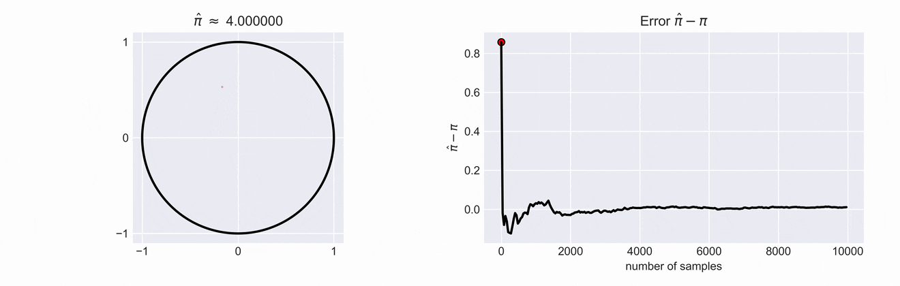
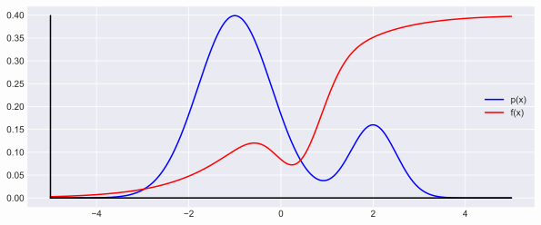
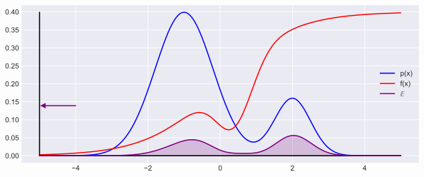
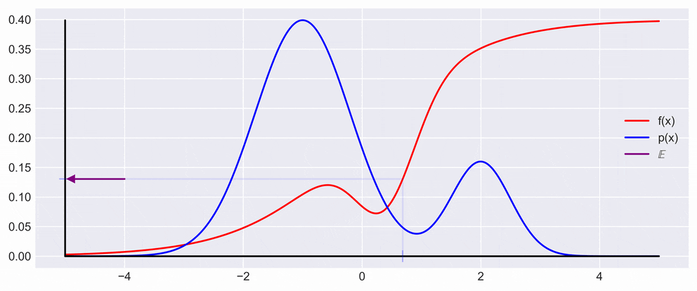
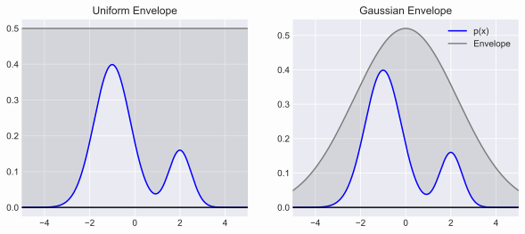
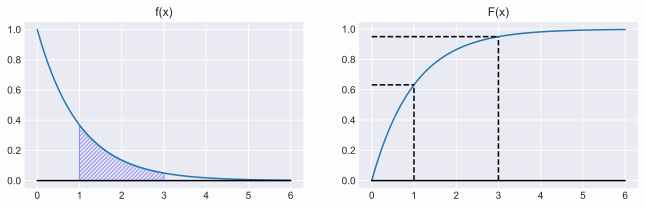
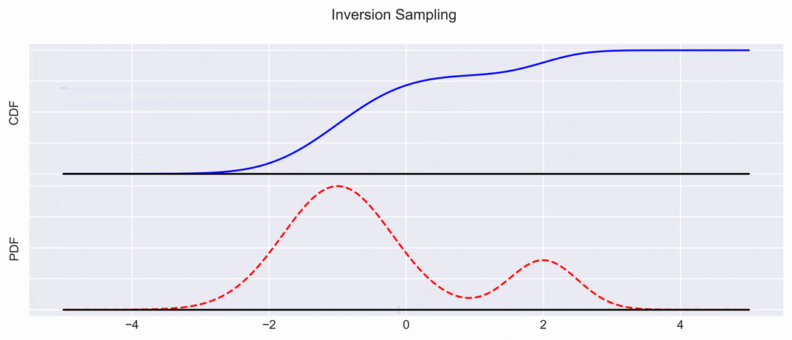
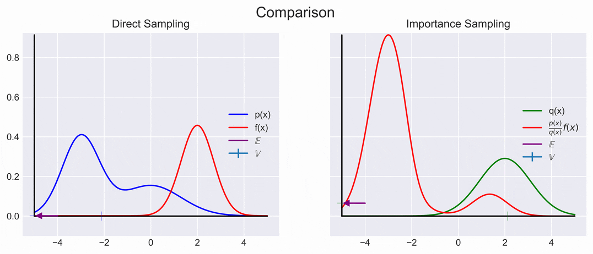

# Monte Carlo "Hello World"
---
We'll start with an intuitive example of estimating $$\pi$$ by throwing darts at a circle inscribed in a square.
We chose a square with side lengths $$2$$, and inscribe a circle of radius $$1$$.
We also have to assume that our thrown darts always hit inside of the square at a point $$\mathbf{p} = (x,y)$$, such that $$x$$ and $$y$$ are $$\textit{iid}$$ and drawn from a Uniform distribution $$\mathcal{U}$$.

So, this means we have the following statements to work with:
* The point $$\mathbf{p}$$ $$(x,y) \sim \mathcal{U}_{[-1,1]}.$$
* Area of the square: $$A_\square=4$$
* Area of the circle: $$A_o = \pi$$

The question boils down to:
*Is the sampled point $$\mathbf{p} = (x,y)$$ inside of the the circle ($$x^2 + y^2 < 1$$)?*

An important observation is that the the ratio of the areas of  of both  $$\frac{A_o}{A_\square}$$ is proportional to the ratio of sampled points, $$\textit{i.e.} \frac{\color{blue}{\#o}}{\color{red}{\#\square} + \color{blue}{\#o}}$$

<!--  -->

If we write down the ratios of the two areas we see that $$\frac{A_o}{A_\square} = \frac{\pi}{4}$$.
This means that if we want to get an estimate for $$\pi$$ we just have to compute $$\hat{\pi} = 4\cdot\frac{\color{blue}{\#o}}{\color{red}{\#\square} + \color{blue}{\#o}}$$.
The estimate $$\hat{\pi}$$ and the error of our estimate is shown in the right plot. You can see how the error decreases as we increase the number of samples.

This little toy example is of course only usefull for illustrative purposes, but introduces important concepts such as _Rejection Sampling_ which we will discuss later from a more theoretical point of view.

# What are Monte Carlo methods for?
---

Monte Carlo(MC) methods can be used to estimate the Expectation $$\mathbb{E}$$ of functions that might be probabilistic in nature, i.e., calculating $$\mathop{\mathbb{E}}[f(x)] = \int f(x)~p(x)~d{x}$$.

<input type="checkbox" id="toggleImages"> Show Expectation <i>(CLICK ME!)</i>

We have to keep in mind that for some problems its is intractable to compute the expression of interest, $$p(x)f(x)$$. And have to resort to some clever way of estimating the expectation.

The idea behind MC is to approximate the expectation as 

$$\mathbb{E}[f(x)] \approx \underbrace{\frac{1}{N} \sum_{i=1}^N(f(x_i))}_{s}, ~~~\text{where  } x_i \sim p(x)$$

<!--  -->

From this formulation it is possible to derive a few interesting things that lead straight to the desirable property of *more samples => less variance in the estimation*.
<!-- Width = $$2 \sqrt(\mathbb{V}_p[s])$$ -->

$$\mathbb{V}_p[s] = \frac{1}{N}\mathbb{V}_p[f(x)]\qquad$$  

This, in effect means that the variance decreases with the number of samples, as is also shown in the figure below. 
What you can see in the figure below is drawing a point $$x$$ from the $$p(x)$$ and multiplying it with $$f$$ evaluated at $$x$$.
In the animation the resulting $$y$$ is then projected back on the $$y$$ axis to show the fluctuation of expectation.

# Central Limit Theorem and Convergence
Following our observations from above it is possible to show the convergence by using the central limit theorem.
The formulas are only shown here for completeness. For the derivation check the resources at the bottom.

$$
s \rightarrow \mathcal{N}(\sigma, \mu^2) 
\begin{cases} 
\mu &= \mathbb{E}[f(x)]\\
\sigma^2 &= \frac{1}{N} \mathbb{V}[f(x)]
\end{cases}
$$

<!-- In reality you only get one sampling of $$s$$ ! -->

$$\mathbb{E}_p[f(x)] = \int p(x) f(x) dx\qquad$$   **Unbiased Estimator**

$$\mathbb{V}_p[f(x)] = \frac{\sigma^2_f}{N} = \mathcal{O} \frac{1}{N}\qquad$$   **Independent of dimension d**

# Sampling
---

> Anyone who considers arithmetical methods of producing random digits is, of course, in a state of sin.
> --- Von Neumann (1951)

Above we glossed over the fact that it is unclear how one can sample from $$p(x)$$. This section will try to solve that confusion.
More concretely we will also discuss how we can sample from arbitrary distributions, and we will discover that as long as we get a source of entropy (or a pseudo-random number generator) that can generate a Uniform distribution, other distributions become feasible.

<!-- * How do we sample from arbitrary distributions?
* How did I produce the $$p(x)$$ samples in the examples above? -->

## Rejection Sampling 

The collary of the above statement is that we can sample any functional form which we can evaluate. An example of such a functional is, for example a gaussian.
We do not need to know how to sample from a gaussian directly, and will use, as mentioned the Uniform distribution $$\mathcal{U_{[0,1]}}$$.

<!--  -->

The basic idea is similar to the example of estimating $$\pi$$ with the dart board, and is visualized above.
Sample from your Uniform distribution an $$x$$ and $$y$$ coordinate for a point, and check if it is above or below the gaussian function, our $$f$$.
If the sample is outside of the gaussian, color it red, otherwise give it a nice blue color. Now reject those red samples and if you got a blue samples, et voila, you just sampled from a gaussian.

The downsides are pretty evident; you need to know _something_ about the underlying function that you want to sample from, for example its spatial extent (the mathy term for that is *support*).
It also struggles with inefficiency, if the envelope is chosen badly.

Choosing better fitting envelopes can dramatically increase the runtime of such methods.
Another thing to consider is that the examples shown here are 1Dimensional. This class of problems generally does not scale nicely with increasing dimensionality, _i.e._ suffers from [Curse of Dimensionality](https://en.wikipedia.org/wiki/Curse_of_dimensionality).

What this means, is that we need to be smarter about it! Rejection sampling alone, for many problems does not suffice, but is always something to keep in the back of your mind.

The summary so far:
* Take a distribution Envelope that we know how to sample from (Uniform 😬)
* Scale it so it covers the target distribution
* Sample from Envelope and reject them if they in the gray area!

Note that this is by FAR not the most effective way to sample from a gaussian. 
Other methods such as Box Muller transform or the Ziggurat algorithm are more efficient for generating samples from a Gaussian distribution. These methods utilize transformations that directly produce values from the desired Gaussian distribution without the need for a rejection step, making them faster and more resource-efficient, especially in cases where high-dimensional data is involved.

The Box-Muller transform starts with two independent uniformly distributed random variables \( U_1, U_2 \) on the interval \( [0, 1] \). It then transforms these into two independent normal random variables \( Z_0 \) and \( Z_1 \) using the following equations:

$$ Z_0 = \sqrt{-2 \log(U_1)} \cos(2\pi U_2) $$

$$Z_1 = \sqrt{-2 \log(U_1)} \sin(2\pi U_2)$$

Here, $$ \sqrt{-2 \log(U_1)} $$ changes the radial distribution to fit a normal distribution, and $$ \cos(2\pi U_2) $$ and $$\sin(2\pi U_2)$$ distribute this value evenly along the circumference of a circle, ensuring the resulting variables are normally distributed due to the circular symmetry of the Gaussian function.

<!--  -->

## Inversion Sampling

A quick refresher on what a **PDF** (Probability Density Function) is (Left in the Figure):

A PDF can give us the probability for a range. In the example above we're given the function $$e^{-x}$$, and want to compute the probability of choosing a value between 1, and 3, given the PDF. This, as you might remember, is done through integration.

$$
f_X(x) = \begin{cases}
   0,& x <  0\\
   e^{-x},        & x \geq 0
\end{cases}
\qquad
\begin{aligned}
P(1 < X < 3) &= \int_1^3 f_X(x) dx \\
             &= \int_1^3 e^{-x} dx \\
             &= e^{-1} - e^{-3}
\end{aligned}
$$

The **CDF** (Cumulative Density Function), shown in the right plot, allows us to get to the same result without laborious integration.

$$
\begin{aligned}
F_X(x) &= P(X \leq x) = \int_{-\infty}^x f_X(x)~dx =  \int_{-\infty}^0 f_X(x)~dx +  \int_{0}^x f_X(x)~dx \\
       &= \int_{0}^x f_X(x)~dx \\
       &= \int_{0}^x e^{-x}~dx \\
       &= 1-e^{-x} \\
\end{aligned}
$$

We just evaluate the antiderivative (*Stammfunktion*) at 1, and 3; subtract one from the other, and we're done:

$$
\begin{aligned}
P(1 < X < 3) &= P(X \leq 3) - P(X \leq 1)\\
             &=F_X(3) - F_X(1)
\end{aligned}
$$

In the end this leaves us with a rather elegant solution, such that we only need to evaluate $$F_X$$ at two points to get the area under the curve of $$f(x)$$.

<!--  -->

In physics and other sciences it is often easier to measure the CDF of a series of events and intractable or impossible to truly observe the PDF.
However with inversion sampling there's a cool trick:
We sample uniformly along the $$y$$-axis of the CDF, and project the samples down on the $$x$$ axis:

This gives us samples, which can then be again transformed into a PDF with kernel density estimation methods for example.

So summarizing: just by knowing how to sample from $$\mathcal{U_{[0,1]}}$$ and the CDF we can draw samples from the PDF. Cool!

Some considerations:
* You need access to the CDF
    * Often times this is possible in the real world; think physical experiments
* Elegent solution that does not do any *unneccessary* computation
* Unfortunately this does not scale well to higher dimensions

This *not scaling well to higher dimensions* is unfortunately a recurring theme, and is just due to the fact that in higher dimensions any PDF is mostly 0 everywhere. Sad.

# Importance Sampling
The last sampling strategy that we will look at is importance sampling.
It tries to deal with the following problem: assume that $$p(x)$$ is small in regions where $$f(x)$$ is large.
When you sample these large values of $$f(x)$$ will be chosen very rarely, as the probability at that point is low. However _if_ a value is chosen the Expectation suddenly jumps more that you might expect. This sudden jump can be described by the Variance $$\mathbb{V}$$.
Importance sampling is a way to decrease the variance $$\mathbb{V}$$ in such scenarios.

Remember that we want to approximate $$\mathop{\mathbb{E}}[f(x)]$$.
We will introduce a secondary distribution $$q(x)$$:

$$
\begin{aligned}
\mathop{\mathbb{E_p}}[f(x)] &= \int p(x)~f(x)~dx  \qquad | \text{multiply by } \frac{q(x)}{q(x)}\\
                          &= \int q(x) \left[\frac{p(x)}{q(x)}  f(x) \right] dx \\
                          &= \mathbb{E}_q \left[\frac{p(x)}{q(x)} f(x) \right]
\end{aligned}
$$

The nice thing here is that we can estimate this with samples $$x_i \sim q$$

A visual representation of direct and importance sampling is shown below. We can see that they converge to the same Expectation, but that the Variance is much smaller.

$$
\begin{aligned}
\mathbb{E}_q \left[\frac{p(x)}{q(x)} f(x) \right] \approx \underbrace{\frac{1}{N} \sum_{i=1}^N\frac{p(x_i)}{q(x_i)} f(x_i)}_{r}
\end{aligned}
$$

<!--  -->

## Convergence

Unbiased $$\mathbb{E}_q[r] = \mathbb{E}_p[f(x)]$$

Same or better variance $$\mathbb{V}_q[r] = \frac{1}{N} \mathbb{V}_q \left[\frac{p(x)}{q(x)} f(x) \right]$$
* choose $$q$$ such that $$\mathbb{V}_q \left[\frac{p(x)}{q(x)} f(x) \right] < \mathbb{V}_p[f(x)]$$

We can achieve this by choosing $$q(x)$$ to be high were $$\|p(x)f(x)\|$$ is high.
However, knowing where  $$\|p(x)f(x)\|$$ is large is not always easy, so choosing an appropriate $$q(x)$$ might be difficult; *oh well*.

# Further Reading
--- 

Intro
* [Intro by Ian Murray](https://www.youtube.com/watch?v=Em6mQQy4wYA)
* [Another intro by Ian Murray](https://www.youtube.com/watch?v=_v4Eb09qp7Q)
* [Betancourt, Introduction to Hamiltonian Monte Carlo](https://arxiv.org/pdf/1701.02434.pdf)
* [Murphy, Advanced Topics in Probabilistic ML, Chapters 11 & 12](https://probml.github.io/pml-book/book2.html#toc)

Details
* [Bishop online](https://www.microsoft.com/en-us/research/uploads/prod/2006/01/Bishop-Pattern-Recognition-and-Machine-Learning-2006.pdf)
* [Galton board as a Markov Chain](https://vknight.org/blog/posts/galton-board/)
* [Inversion / Box Muller](https://www.youtube.com/watch?v=Vd21DUyVccA&ab_channel=Anthroporraistes)
* [Monte Carlo with Math](https://www.youtube.com/watch?v=C3p2wI4RAi8&ab_channel=MutualInformation)
* [Deriving the Normal Distribution Probability Density Function Formula](https://www.youtube.com/watch?v=N-bI-Dsm-rw&ab_channel=MolloyMaths)
* [MCMC slides (nice overview)](http://www.cs.cmu.edu/~aarti/Class/10701_Spring14/slides/MCMC.pdf)
* [German MCMC slides (mathy)](https://user.math.uni-bremen.de/dickhaus/downloads/Methoden-WS1213/mcmc.pdf)
* Another nice slide set on Monte Carlo + MCMC + MH algorithm:
    * [MC](https://www.sas.upenn.edu/~jesusfv/LectureNotes_5_montecarlo.pdf)
    * [MCMC](https://www.sas.upenn.edu/~jesusfv/LectureNotes_6_mcmc.pdf)
    * [MH](https://www.sas.upenn.edu/~jesusfv/LectureNotes_7_MH.pdf)

---
*Most of this page is built based from my [MCMC intro jupyter notebook](https://github.com/f-ilic/cib_seminar).
The only real difference is that the notebook is interactive; feel free to tinker with it and let me know if you create some additional nice visualizations.*

---

<!-- JAVSCRIPT STUFF -->

