<script async defer src="https://buttons.github.io/buttons.js"></script>

<div style="display: flex; justify-content: flex-start">
<a class="github-button" href="https://github.com/f-ilic/AppearanceFreeActionRecognition" data-icon="octicon-star" data-show-count="true" aria-label="Star f-ilic/AppearanceFreeActionRecognition on GitHub">Star</a>
</div>
<style>
  .video-container {
  position: relative;
  padding-bottom: 56.25%;
}

.video-container iframe {
  position: absolute;
  top: 0;
  left: 0;
  width: 100%;
  height: 100%;
}
</style>


<div class="slideshow-container">

  <!-- Full-width images with number and caption text -->
  <div class="mySlides1 fade">
    <center>
    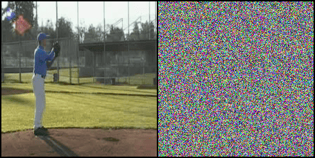
    <div class="text">Baseball Pitch</div>
    </center>
  </div>

  <div class="mySlides1 fade">
    <center>
    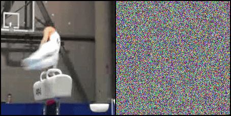
    </center>
    <div class="text">Pommel Horse</div>
  </div>

  <div class="mySlides1 fade">
    <center>
    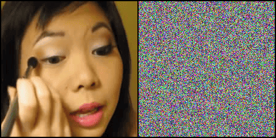
    </center>
    <div class="text">Apply Eye Makeup</div>
  </div>

  <div class="mySlides1 fade">
    <center>
    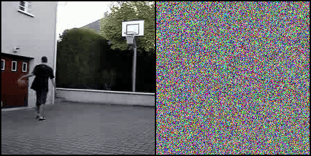
    </center>
    <div class="text">Basketball</div>
  </div>

  <div class="mySlides1 fade">
    <center>
    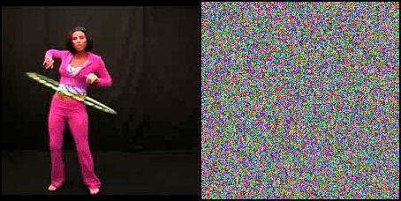
    </center>
    <div class="text">HulaHoop</div>
  </div>
  <a class="prev" onclick="plusSlides(-1, 0)">&#10094;</a>
  <a class="next" onclick="plusSlides(1, 0)">&#10095;</a>
</div>
<br>
<!-- The dots/circles -->
<div style="text-align:center">
  <span class="myDots1 dot" onclick="currentSlide(1, 0)"></span>
  <span class="myDots1 dot" onclick="currentSlide(2, 0)"></span>
  <span class="myDots1 dot" onclick="currentSlide(3, 0)"></span>
  <span class="myDots1 dot" onclick="currentSlide(4, 0)"></span>
  <span class="myDots1 dot" onclick="currentSlide(5, 0)"></span>
</div>
<br>

x
**Can Neural Networks recognize actions solely from the temporal dynamics?**
We investigate state-of-the-art action recognition networks with respect to their performance on a dataset where no static information is present. The video shows random noise animated with motion extracted from real human motion (the UCF101 dataset). We find that optical flow, or a similarly descriptive representation, is <u>not an emergent property</u> of any of the tested <u>action recognition architectures</u>.
<br>

---


Related work has shown often that static biases in action recognition datasets and therefore also in the trained models exist.
A simple experiment demonstrates that singleframe classification performance of a ResNet50 on UCF101 frames yields 65.6% Top-1 accuracy.
<br>

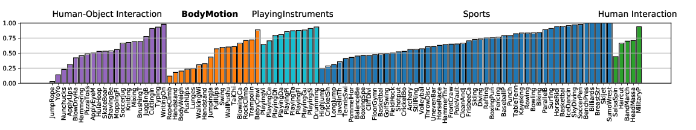

<br>
The Appearance Free Dataset (AFD) disentangles static and dynamic video components. In particular, <u>no single frame contains any static discriminatory information</u> in AFD; the action is only encoded in the temporal dimension.

<!-- Slideshow container -->
<div class="slideshow-container">

  <!-- Full-width images with number and caption text -->
  <div class="mySlides2 fade">
    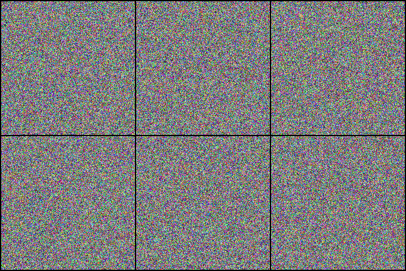
    <div class="text">Jumping Jacks</div>
  </div>
  <div class="mySlides2 fade">
    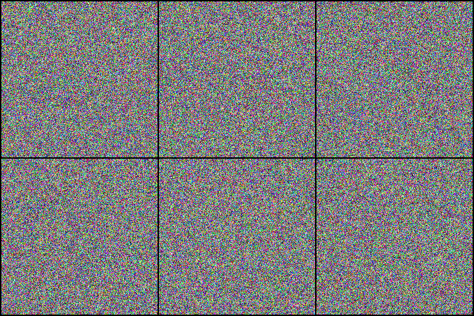
    <div class="text">Table Tennis</div>
  </div>
  <div class="mySlides2 fade">
    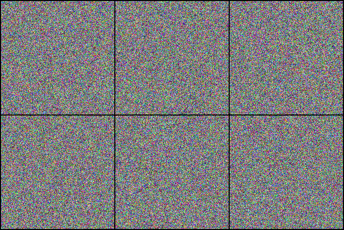
    <div class="text">Weightlifting</div>
  </div>
  <a class="prev" onclick="plusSlides(-1, 1)">&#10094;</a>
  <a class="next" onclick="plusSlides(1, 1)">&#10095;</a>
</div>
<br>

<!-- The dots/circles -->
<div style="text-align:center">
  <span class="myDots2 dot" onclick="currentSlide(1, 1)"></span>
  <span class="myDots2 dot" onclick="currentSlide(2, 1)"></span>
  <span class="myDots2 dot" onclick="currentSlide(3, 1)"></span>
</div>
<br>
<br>

---

AFD101 is based on UCF101. We provide code and other necessary tools to generate other appearance free videos.

We also perform a user study, showing that human participants can detect the motion from the animated noise patter, and perform much better than current networks. The top row shows human performance on "normal" videos, and the bottom row on our "noisy" videos.

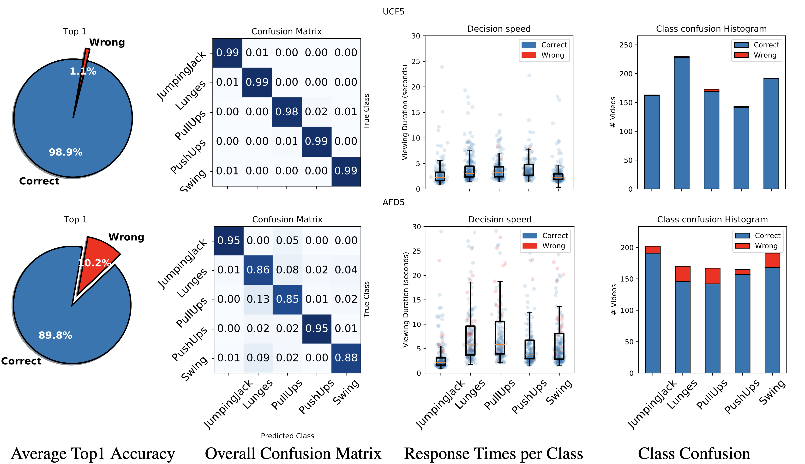

<br>
It's also possible to start with different noise, such as sparse noise, and still descern moving shapes.

<table>
<tr>
<td> 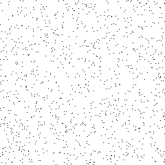  </td>
<td> 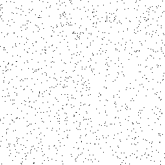  </td>
<td> 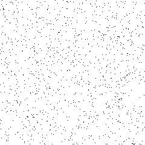  </td>
</tr>
</table>

Using sparse noise, we can create videos that evoke a similarity, at least in spirit, to the perceptual organization experiments of simple movements performed by psychologist Gunnar Johansson <a href="https://link.springer.com/article/10.3758/bf03212378"> <abbr title="Johansson, Gunnar. Visual perception of biological motion and a model for its analysis. Perception & psychophysics 14.2 (1973): 201-211.">[`Ref`]</abbr></a>.

<video controls autoplay loop muted playsinline width="100%">
<source  src="../papers/AppearanceFreeActionReconigtion/walkingdots.mp4" type="video/mp4">
</video> 
<a href="https://www.youtube.com/watch?v=wG_U5m4FShs">[`Credit`]</a>


---

One of our contributions is to show how to build a (new) Two-Stream architecture in a pricipled manner, to encourage a robust modeling of the temporal dimension.
<br>
<br>


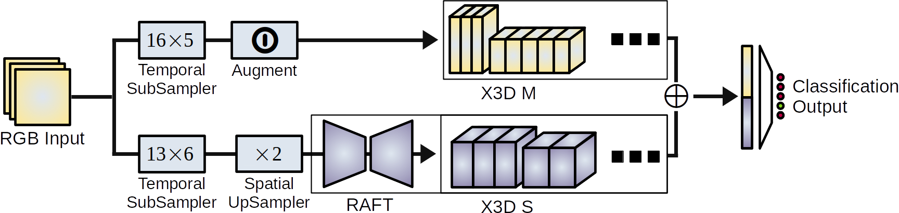


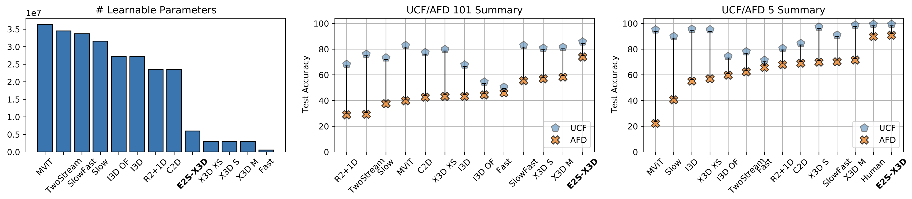
<br>
We employ a state of the art optical flow estimator to generate a rich dynamics representation that outperforms all others on Appearance Free Data, and closes the gap to human performance significantly.
<br>
<br>

# Cite
```bibtex
@InProceedings{ilic22appearancefree,
title={Is Appearance Free Action Recognition Possible?},
author={Ilic, Filip and Pock, Thomas and Wildes, Richard P.},
booktitle={European Conference on Computer Vision (ECCV)},
month={October},
year={2022},
}
```

<script>
let slideIndex = [1,1];
let dotIndex = [1,1];
/* Class the members of each slideshow group with different CSS classes */
let slideId = ["mySlides1", "mySlides2"];
let dotId = ["myDots1", "myDots2"];
showSlides(1, 0);
showSlides(1, 1);


// Thumbnail image controls
function currentSlide(n, no) {
  showSlides(slideIndex[no] = n, no);
}

function plusSlides(n, no) {
  showSlides(slideIndex[no] += n, no);
}

function showSlides(n, no) {
  let i;
  let x = document.getElementsByClassName(slideId[no]);
  let dots = document.getElementsByClassName(dotId[no]);

  if (n > x.length) {slideIndex[no] = 1}
  if (n < 1) {slideIndex[no] = x.length}
  for (i = 0; i < x.length; i++) {
    x[i].style.display = "none";
  }
  for (i = 0; i < dots.length; i++) {
    // alert(dots.length)
    dots[i].className = dots[i].className.replace(" active", "");
  }
  x[slideIndex[no]-1].style.display = "block";
  dots[slideIndex[no]-1].className += " active";

}
</script>