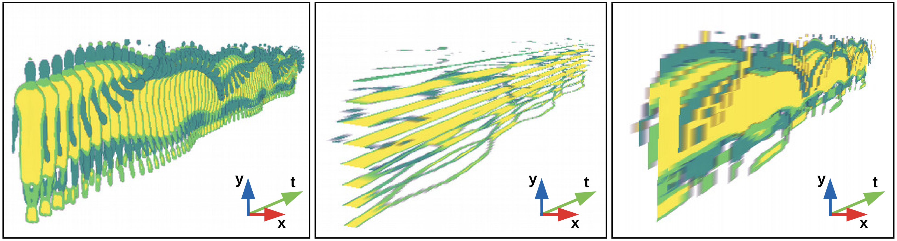

<!-- We show how to obtain a scalable representation of objects, which preserves their decomposition into parts. We extract features from appearance and motion, select the appropriate scale in spatio-temporal Gaussian scale space, and perform clustering. -->
<video autoplay loop muted playsinline width="100%">  <source  src="papers/STVI/girl.mp4" type="video/mp4"></video>
**We show how to combine low-level video segmentation, which often lack semantic knowledge, with a masking network to get the best of both worlds.**
Object tracking and decomposition into parts: Our approach (right) bridges the conceptual gap between low-level video representations such as (left) Temporal Super-Pixels which tend to fall apart over time and do not model objects directly, and instance segmentation methods such as (center) Mask R-CNN  which lack a decomposition into parts, and temporal consistency. Our unsupervised approach is able to detect salient object parts based on motion and appearance.

# Overview and Examples
---

<br>
<video autoplay loop muted playsinline width="100%"> <source  src="papers/STVI/jumpingjack.mp4" type="video/mp4"> </video>
Different object scales: Space-Time Volumes of Interest extracted at increasing spatial and temporal scales from a jumping-jack sequence. Note how finer scales capture more detail at the cost of temporal and spatial coherence, whereas coarser scales model more fundamental patterns.

<br>

The extracted representation is inherently a volumetric one, allowing us to slice along any of the axis.
This can reveal interesting details such as the tube in the center image formed by the oscillating motion of the legs.


<br>
<center><video autoplay loop muted playsinline width="70%"><source  src="papers/STVI/rollerblade.mp4" type="video/mp4"></video> </center>
Viewer/Object-centered representation: The trajectory w.r.t. the observer is shown on the left. The relative motion of object parts w.r.t. the object centroid is shown on the right. This is useful because objects are represented as the sum of their parts, and not just as instance masks.


# Supplement
---

<center><video autoplay loop muted playsinline width="100%"><source  src="papers/STVI/parts/DAVIS_parts.mp4" type="video/mp4"></video></center>
The DAVIS Parts Dataset contains a variety of densely annotated objects and their parts. We envision this dataset being used for object part tracking and detection.


# Cite
---
```bibtex
@InProceedings{ilic20wacv,
author = {Ilic, Filip and Pinz, Axel},
title = {Representing Objects in Video as Space-Time Volumes by Combining Top-Down and Bottom-Up Processes},
booktitle = {The IEEE Winter Conference on Applications of Computer Vision (WACV)},
month = {March},
year = {2020}
} 
```