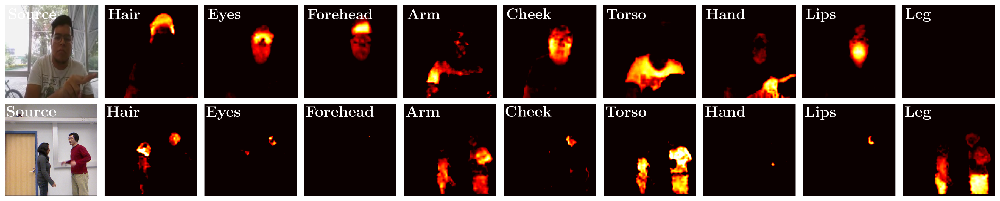
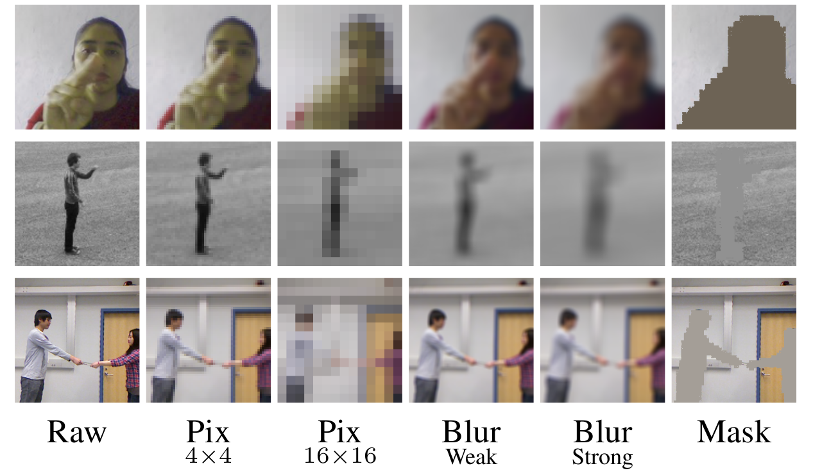

<a class="github-button" href="https://github.com/f-ilic/SelectivePrivacyPreservation" data-icon="octicon-star" data-show-count="true" aria-label="Star f-ilic/SelectivePrivacyPreservation on GitHub">Star</a>

<video controls autoplay loop muted playsinline width="100%">
  <source  src="../papers/SelectivePrivacyPreservation/teaser.mp4" type="video/mp4">
</video> 

**The goal is to hide privacy relevant attributes without action recognition performance dropping.**
We show that it is not necessary to train action recognition and privacy networks in an adversarial fashion for effective obfuscation of privacy attributes while maintaining strong action recognition performance. We show that a system based on local privacy templates, deep features that capture <u>template semantics</u> and <u>selective noise obfuscation</u> that is animated with source video motion can uphold privacy without hindering action recognition. Our approach is unique compared to alternative recent approaches in terms of <u>interpretability</u>.

 

Lore ipsum Lore ipsum Lore ipsum Lore ipsum Lore ipsum Lore ipsum Lore ipsum Lore ipsum Lore ipsum Lore ipsum Lore ipsum Lore ipsum Lore ipsum Lore ipsum Lore ipsum Lore ipsum Lore ipsum Lore ipsum Lore ipsum Lore ipsum Lore ipsum Lore ipsum Lore ipsum Lore ipsum Lore ipsum Lore ipsum Lore ipsum Lore ipsum Lore ipsum Lore ipsum Lore ipsum Lore ipsum Lore ipsum Lore ipsum Lore ipsum Lore ipsum Lore ipsum Lore ipsum Lore ipsum Lore ipsum Lore ipsum Lore ipsum Lore ipsum Lore ipsum Lore ipsum Lore ipsum Lore ipsum Lore ipsum Lore ipsum Lore ipsum Lore ipsum Lore ipsum Lore ipsum Lore ipsum Lore ipsum Lore ipsum Lore ipsum  

 

Lore ipsum Lore ipsum Lore ipsum Lore ipsum Lore ipsum Lore ipsum Lore ipsum Lore ipsum Lore ipsum Lore ipsum Lore ipsum Lore ipsum Lore ipsum Lore ipsum Lore ipsum Lore ipsum Lore ipsum Lore ipsum Lore ipsum Lore ipsum Lore ipsum Lore ipsum Lore ipsum Lore ipsum Lore ipsum Lore ipsum Lore ipsum Lore ipsum Lore ipsum Lore ipsum Lore ipsum Lore ipsum Lore ipsum Lore ipsum Lore ipsum Lore ipsum Lore ipsum Lore ipsum Lore ipsum Lore ipsum Lore ipsum Lore ipsum Lore ipsum Lore ipsum Lore ipsum Lore ipsum Lore ipsum Lore ipsum Lore ipsum Lore ipsum Lore ipsum Lore ipsum Lore ipsum Lore ipsum Lore ipsum Lore ipsum Lore ipsum  