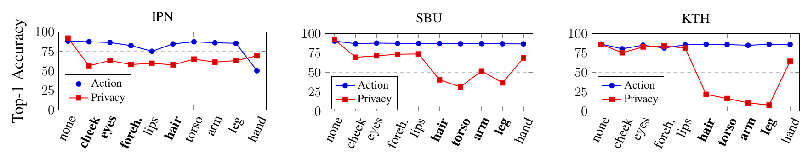

<script async defer src="https://buttons.github.io/buttons.js"></script>
<div style="display: flex; justify-content: flex-start">
<a class="github-button" href="https://github.com/f-ilic/SelectivePrivacyPreservation" data-icon="octicon-star" data-show-count="true" aria-label="Star f-ilic/SelectivePrivacyPreservation on GitHub">Star</a>
</div>

<script src="https://cdn.mathjax.org/mathjax/latest/MathJax.js?config=TeX-AMS-MML_HTMLorMML" type="text/javascript"></script>

<video controls autoplay loop muted playsinline width="100%">
  <source  src="../papers/SelectivePrivacyPreservation/teaser.mp4" type="video/mp4">
</video> 
<br>

**The goal is to hide privacy relevant attributes without action recognition performance dropping.**
We show that it is not necessary to train action recognition and privacy networks in an adversarial fashion for effective obfuscation of privacy attributes while maintaining strong action recognition performance. We show that a system based on local privacy templates, deep features that capture <u>template semantics</u> and <u>selective noise obfuscation</u> that is animated with source video motion can uphold privacy without hindering action recognition. Our approach is unique compared to alternative recent approaches in terms of <u>interpretability</u>.

---

The gist of our method is that we have templates that we match with DINO-ViT features to find saliency regions in the input video that we need to hide.


In our particular case we manually select the DINO-ViT templates to correspond to `keys` extracted from the `11`th encoder block for maximal semantic meaning.
The regions in the input image that correspond to the features are shown below.

<p>
<center>

</center>
</p>

<u>Choosing this Library of templates enables us now to create saliency maps, where regions that are similar to templates have high values.
This manual choice of templates leads to interpretability by design to some extent as the results similarities will be close to concepts that were previously selected.
We also hypothesise that it is possible to learn good feature descriptors or exemplar images and patches from which to extract good privacy preserving templates. </u>


Our project focuses on enhancing privacy in action recognition systems through a carefully designed template selection process. We've developed a library of image patches, each representing different privacy-sensitive attributes like facial features and body parts. This library is the cornerstone of our method, allowing us to selectively obscure specific elements of an individual's identity that need protection.

For template matching, we employ DINO-ViT features for their semantic accuracy. This enables our system to detect and match privacy-sensitive regions in video frames with our predefined templates accurately. The process is precise, ensuring that only targeted areas are obscured, thus preserving the necessary context for action recognition.

This section includes embedded videos and images to illustrate the template selection and matching process. These examples provide a clear view of how our method effectively balances privacy preservation with the utility of action recognition technologies.


<p>
<video controls autoplay loop muted playsinline width="100%">
  <source  src="../papers/SelectivePrivacyPreservation/saliency.mp4" type="video/mp4">
</video> 
</p>

<u>Identified regions that correlate highly with privacy relevant features must now be obfuscated.
Our goal is to obfuscate only the relevant parts, in a manner that impacts the action recognition perforamnce as little as possible.
For that we choose to obsucate with temporally consistent noise, such that action recognition networks are still able to extract some meaningful data from the dynamics in the video.</u>


In our approach, the creation of saliency maps plays a pivotal role in identifying which areas within a video frame are privacy-sensitive and thus should be obscured. After selecting the appropriate templates, our system generates saliency maps by comparing these templates against each video frame. These maps highlight the regions that match our privacy-sensitive attributes, effectively pinpointing where obfuscation is needed.

Once we've identified these regions, we employ a novel technique to overlay noise specifically on these salient areas. This process is guided by the saliency maps, ensuring that the noise application is both selective and precise. The key here is to maintain the integrity of the video's motion and overall context, crucial for action recognition, while effectively masking personal attributes. We leverage optical flow information from the source video to animate this noise, preserving the motion and dynamic aspects of the scene. This method allows us to achieve a fine balance: protecting privacy while retaining the video's utility for action recognition.

Examples of such temporally consistent noise is shown below and is inspired by [our previous work](/AppearanceFreeActionRecognition).


$$
s_j = \frac{1}{|\tilde{\mathsf{T}}|} \sum_{i=1}^{|\tilde{\mathsf{T}}|} \max\left(0, \frac{ \langle \mathsf{K}(\tau_i), \mathsf{K}(I_j)\rangle}{\|\mathsf{K}(\tau_i)\|\|\mathsf{K}(I_j)\|}\right), \forall j \in \{1,..., m\}
$$


We compare across many different architectures and show that our relatively simple approach of finding similarities and masking it with temporally consistent noise works quite well across different datasets.


Our evaluation is such that we average overmultiple network architectures and report the average.

<table style="table-layout: fixed; width:100%">
<tr>
<td>   </td>
<td>   </td>
<td>   </td>
</tr>
</table>





# Cite

```bibtex
@inproceedings{ilic2024selective,
title={Selective, Interpretable and Motion Consistent Privacy Attribute Obfuscation for Action Recognition},
author={Ilic, Filip and Zhao, He and Pock, Thomas and Wildes, Richard P.},
booktitle={Conference on Computer Vision and Pattern Recognition (CVPR)},
year={2024}
}
```