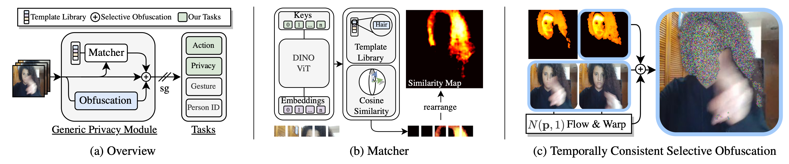
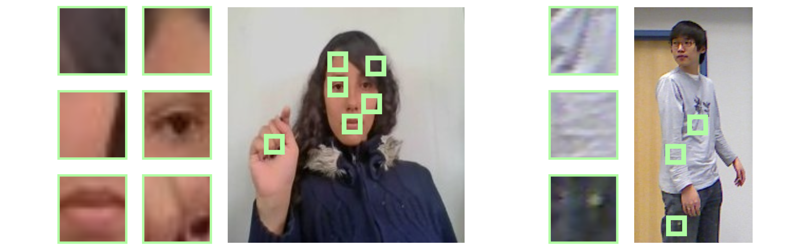
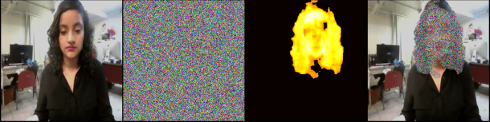
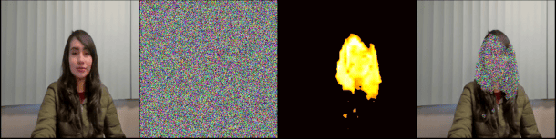
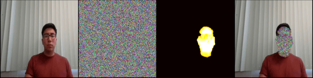
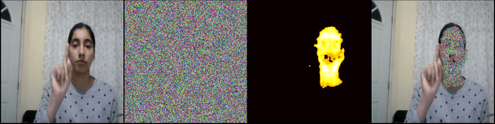
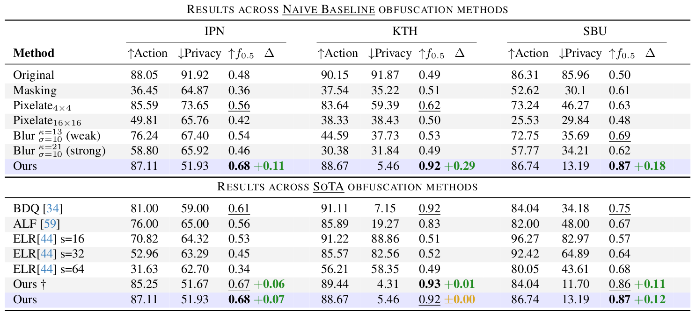
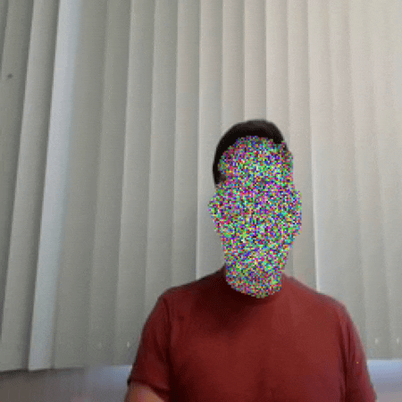
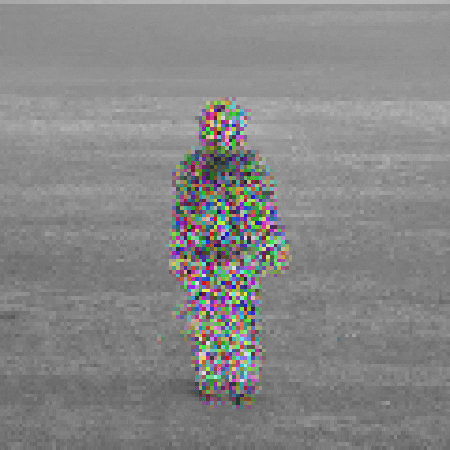
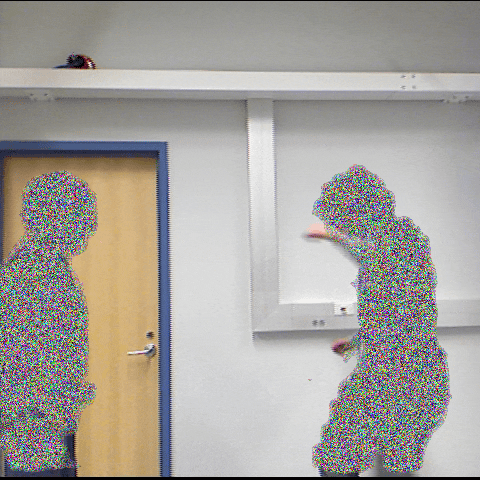

<script async defer src="https://buttons.github.io/buttons.js"></script>
<div style="display: flex; justify-content: flex-start">
<a class="github-button" href="https://github.com/f-ilic/SelectivePrivacyPreservation" data-icon="octicon-star" data-show-count="true" aria-label="Star f-ilic/SelectivePrivacyPreservation on GitHub">Star</a>
</div>

<script type="text/javascript" id="MathJax-script" async
  src="https://cdn.jsdelivr.net/npm/mathjax@3.2.2/es5/tex-mml-chtml.js">
</script>


<video autoplay loop muted playsinline width="100%">
  <source  src="../papers/SelectivePrivacyPreservation/teaser.mp4" type="video/mp4">
</video> 
<br>

**The goal is to hide privacy relevant attributes without action recognition performance dropping.**
We show that it is not necessary to train action recognition and privacy networks in an adversarial fashion for effective obfuscation of privacy attributes while maintaining strong action recognition performance. We show that a system based on local privacy templates, deep features that capture <u>template semantics</u> and <u>selective noise obfuscation</u> that is animated with source video motion can uphold privacy without hindering action recognition. Our approach is unique compared to alternative recent approaches in terms of <u>interpretability</u>.

<!-- <center><em>Overview of our Method</em></center> -->
## Overview



Our method uses templates that we match with DINO-ViT features to find salient regions in video that we need to obfuscate. We create a template library of images, and spatial locations in these images $$ {\tau}_i \in \mathsf{T} $$, which correspond to regions that ought to be obfuscated. In our particular usecase this means regions that can be used to infer labels pertaining to privacy (Skintone, Haircolor, Gender, ...).

<p>
<center><em>ViT-Tokens: Manually Selected Template Features</em></center>
<center>

</center>
</p>

We use the keys of a DINO-ViT as the feature descriptors, as they accumulate contextual and semantic meaning, as depth increases in the Vision Transformer.

## Saliency Computation

To decide how strong a particular patch needs to be obfuscated we use the (positive) cosine similarity between the templates and the image patches. 

$$
s_j = \frac{1}{|\tilde{\mathsf{T}}|} \sum_{i=1}^{|\tilde{\mathsf{T}}|} \max\left(0, \frac{ \langle \mathsf{K}(\tau_i), \mathsf{K}(I_j)\rangle}{\|\mathsf{K}(\tau_i)\|\|\mathsf{K}(I_j)\|}\right), \forall j \in \{1,..., m\}
$$

The resulting saliency map is then bilinearly upscaled, to be of the same dimension as the input image.
This process ensures that only targeted areas are obscured, thus preserving the, often critical, context for action recognition.

<p>
<center><em>Saliency Maps of individual templates matched across 4 input videos</em></center>
<video autoplay loop muted playsinline width="100%">
  <source  src="../papers/SelectivePrivacyPreservation/saliency.mp4" type="video/mp4">
</video> 
</p>

These maps highlight the regions that match our privacy-sensitive attributes, effectively pinpointing where obfuscation is needed.

## Temporally Consistent Masking

Once we've identified these regions, we overlay temporally consistent noise on the input video, guided by the saliency maps.The key here is to maintain the integrity of the video's motion and overall context, crucial for action recognition, while effectively masking personal attributes. 

Examples of such temporally consistent noise are found on the project page of [our previous work](/AppearanceFreeActionRecognition).
Below we show examples of input video, motion consistent noise, the saliency maps, and the final masked output that is used in the action recognition networks.

<center><em>Examples of intermediate results, and the final obfuscated output.</em></center>
<!-- Slideshow container -->
<div class="slideshow-container" data-slideshow="spp-examples">

  <!-- Full-width images with number and caption text -->
  <div class="slide fade">
    
  </div>
  <div class="slide fade">
    
  </div>
  <div class="slide fade">
    
  </div>
  <div class="slide fade">
    
  </div>
  <a class="prev" role="button" tabindex="0" aria-label="Previous slide">&#10094;</a>
  <a class="next" role="button" tabindex="0" aria-label="Next slide">&#10095;</a>
</div>
<p>
<!-- The dots/circles -->
<div style="text-align:center" data-slideshow-dots="spp-examples">
  <span class="dot" role="button" tabindex="0" aria-label="Show slide 1"></span>
  <span class="dot" role="button" tabindex="0" aria-label="Show slide 2"></span>
  <span class="dot" role="button" tabindex="0" aria-label="Show slide 3"></span>
  <span class="dot" role="button" tabindex="0" aria-label="Show slide 4"></span>
</div>
</p>


## Results
We compare across 11 Action Reocgnition, and 6 Privacy Attribute Classification architectures; We show across all three tested datasets ([IPN](https://gibranbenitez.github.io/IPN_Hand/), [SBU](http://vision.cs.stonybrook.edu/~kiwon/Datasets/SBU_Kinect_Interactions/README.txt), [KTH](https://www.csc.kth.se/cvap/actions/)) that our relatively simple approach of finding similarities and masking it with temporally consistent noise works quite well and outperforms other approaches that require training for each specific architecutre.



<!-- <p>
<table style="table-layout: fixed; width:100%">
<tr>
<td>   </td>
<td>   </td>
<td>   </td>
</tr>
</table>
</p> -->

## Cite
```bibtex
@inproceedings{ilic2024selective,
title={Selective, Interpretable and Motion Consistent Privacy Attribute Obfuscation for Action Recognition},
author={Ilic, Filip and Zhao, He and Pock, Thomas and Wildes, Richard P.},
booktitle={Conference on Computer Vision and Pattern Recognition (CVPR)},
year={2024}
}
``` 

## Further Reading

<div class="card-list">

  
  

</div>


<script src="{{ "/assets/js/slideshow.js" | relative_url }}"></script>