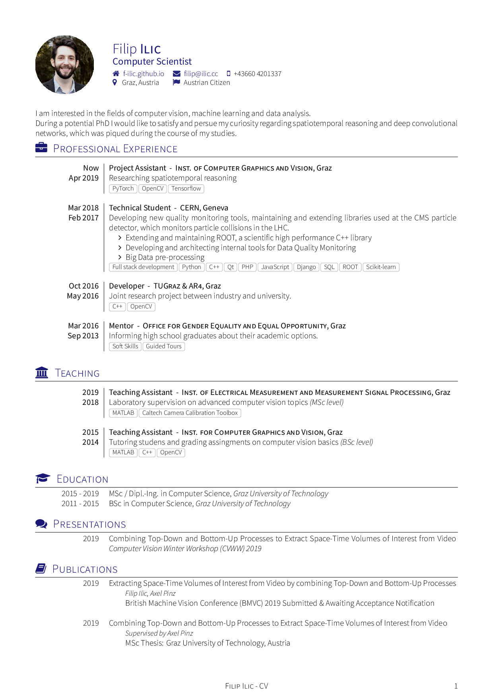

<h2>Short bio
</h2>

I'm currently a PhD student at the TU Graz. 
My interests lie in the fields of  computer vision, machine learning and data analysis. I know my way around various different toolchains and technologies, with which I enjoy to tinker. 
During my spare time I enjoy cycling, and in winter snowboarding for which I have been an instructor since 2008. 
If you're interested in getting in contact with me, just write me an email.

---
<!-- convert -density 150 cv.pdf[0] -quality 90 cv.png -->
Here's my CV: 

