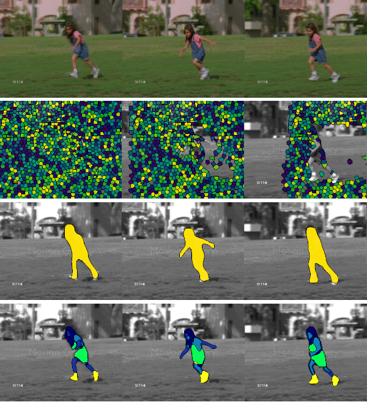

## Short bio
---

I'm currently a PhD student at the TU Graz, interested in machine learning and its applications in computer vision.
My current work focuses on the spatio-temporal relation between objects and their parts in video.

## Publications
---

<table class='tiles'>
  <tr>
    <td width="20%" class='teaserimg'> </td>
    <td width="80%">  
      

      

        Representing Objects in Video as Space-Time Volumes by Combining Top-Down and Bottom-Up Processes
        <b>Filip Ilic</b>, Axel Pinz
        <b>WACV 2020</b>
      

      

      

      <a href="/STVI">[Info Page]</a>
      <a href="papers/STVI/stvi.pdf">[Paper]</a>
      <a href="papers/STVI/poster.pdf">[Poster]</a>
      <a href="papers/STVI/bib.txt">[BibTex]</a>
      

    </td>
  </tr>
</table>

## Teaching
---

<table class='tiles'>
  <tr>
    <td>
    
Winter semester 

        
Image Based Measurement

        
Laboratory (438.019)

      

      <a href="../teaching/report_template.tex">[Report Template]</a>
      
    
    </td>
  </tr>
</table>

## Open Student Projects
---
<table class='tiles'>
  <tr>
    <td width="20%" class='teaserimg'> </td>
    <td width="80%">  
        
Oct 2018

        
Space-Time Interest Points

        
Bachelor's Thesis, Master's Project

        

        Implement a Space-Time Interest Point detector and experiment with different descriptors for action recognition.
        

      

      <a href="../teaching/stip.pdf">[Info PDF]</a>
      <a href="https://www.irisa.fr/vista/Papers/2005_ijcv_laptev.pdf">[Reference paper]</a>
      

    </td>

  </tr>
</table>