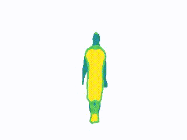

<h1>Space-Time Volumes of Interest</h1>

Exploring and representing objects at various spatio-temporal scales from video

[ [Paper] ](projects/STVI/cvpr19.pdf) [ [Code] ](https://github.com/f-ilic/space-time-volumes) [ [BibTex] ](projects/STVI/bib.txt)

 

<h1>Vocabulary trees for object classification</h1>
Improving the training speed of Vocabulary Trees by a multi-stage clustering of image features.

[ [Paper] ](VocTree_techReport.pdf) [ [BibTex] ]()

 

<h1>Age and Gender estimation from facial images</h1>
[ [Paper] ](AgeGenderBachelor.pdf) [ [BibTex] ]()
