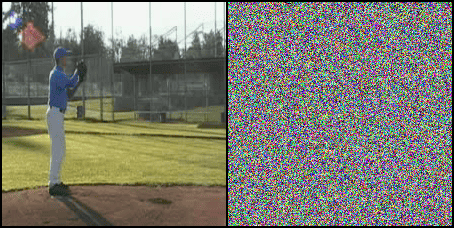
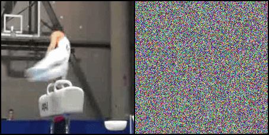
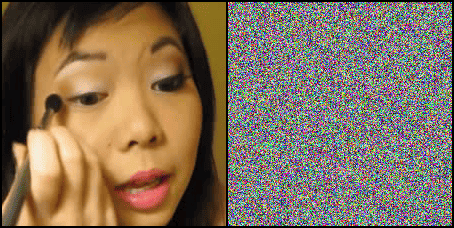
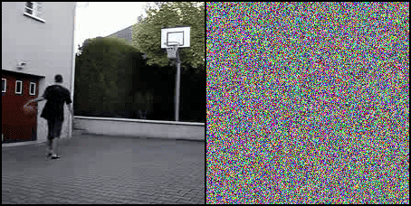
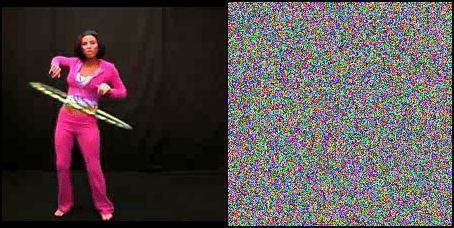
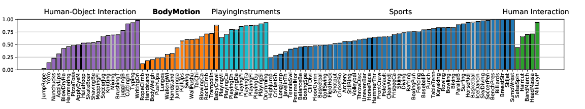
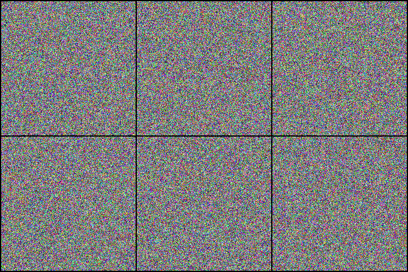
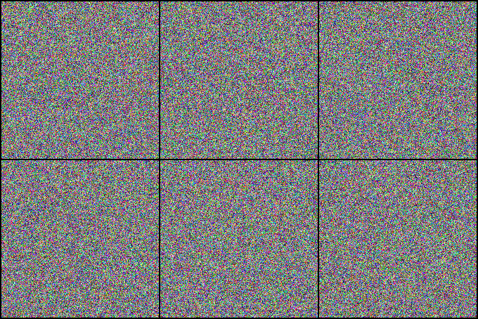
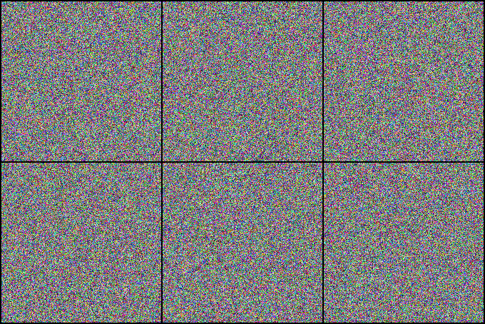
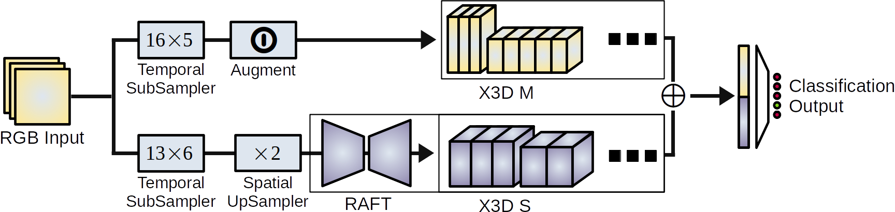

<script async defer src="https://buttons.github.io/buttons.js"></script>

<div class="paper-links">
<a href="https://github.com/f-ilic/AppearanceFreeActionRecognition">Code</a>
<a href="https://arxiv.org/pdf/2207.06261.pdf">Paper</a>
<a href="https://f-ilic.github.io/AppearanceFreeActionRecognition/quiz">Quiz</a>
</div>
<br>
<a class="github-button" href="https://github.com/f-ilic/AppearanceFreeActionRecognition" data-icon="octicon-star" data-show-count="true" aria-label="Star f-ilic/AppearanceFreeActionRecognition on GitHub">Star</a>

<style>
  .video-container {
  position: relative;
  padding-bottom: 56.25%;
}

.video-container iframe {
  position: absolute;
  top: 0;
  left: 0;
  width: 100%;
  height: 100%;
}
</style>


<div class="slideshow-container">

  <!-- Full-width images with number and caption text -->
  <div class="mySlides1 fade">
    <center>
    
    <div class="text">Baseball Pitch</div>
    </center>
  </div>

  <div class="mySlides1 fade">
    <center>
    
    </center>
    <div class="text">Pommel Horse</div>
  </div>

  <div class="mySlides1 fade">
    <center>
    
    </center>
    <div class="text">Apply Eye Makeup</div>
  </div>

  <div class="mySlides1 fade">
    <center>
    
    </center>
    <div class="text">Basketball</div>
  </div>

  <div class="mySlides1 fade">
    <center>
    
    </center>
    <div class="text">HulaHoop</div>
  </div>
  <a class="prev" onclick="plusSlides(-1, 0)">&#10094;</a>
  <a class="next" onclick="plusSlides(1, 0)">&#10095;</a>
</div>
<br>
<!-- The dots/circles -->
<div style="text-align:center">
  <span class="myDots1 dot" onclick="currentSlide(1, 0)"></span>
  <span class="myDots1 dot" onclick="currentSlide(2, 0)"></span>
  <span class="myDots1 dot" onclick="currentSlide(3, 0)"></span>
  <span class="myDots1 dot" onclick="currentSlide(4, 0)"></span>
  <span class="myDots1 dot" onclick="currentSlide(5, 0)"></span>
</div>
<br>

# Overview

We investigate state-of-the-art action recognition networks with respect to their performance on a dataset where no static information is present. The video shows random noise animated with motion extracted from real human motion (the UCF101 dataset). We find that optical flow, or a similarly descriptive representation, is not an emergent property of any of the tested action recognition architectures.
<br>


# Motivation

Related work has shown often that static biases in action recognition datasets and therefore also in the trained models exist.
A simple experiment demonstrates that singleframe classification performance of a ResNet50 on UCF101 frames yields 65.6% Top-1 accuracy.


<br>
# Appearance Free Dataset
The Appearance Free Dataset (AFD) is an extension to a widely used action recognition dataset that
disentangles static and dynamic video components. In particular, no single frame
contains any static discriminatory information in AFD; the action is only encoded in the temporal dimension.

<!-- Slideshow container -->
<div class="slideshow-container">

  <!-- Full-width images with number and caption text -->
  <div class="mySlides2 fade">
    
    <div class="text">Jumping Jacks</div>
  </div>
  <div class="mySlides2 fade">
    
    <div class="text">Table Tennis</div>
  </div>
  <div class="mySlides2 fade">
    
    <div class="text">Weightlifting</div>
  </div>
  <a class="prev" onclick="plusSlides(-1, 1)">&#10094;</a>
  <a class="next" onclick="plusSlides(1, 1)">&#10095;</a>
</div>
<br>

<!-- The dots/circles -->
<div style="text-align:center">
  <span class="myDots2 dot" onclick="currentSlide(1, 1)"></span>
  <span class="myDots2 dot" onclick="currentSlide(2, 1)"></span>
  <span class="myDots2 dot" onclick="currentSlide(3, 1)"></span>
</div>
<br>
<br>

We provide the AFD101 dataset based on UCF101, and also the necessary tools to generate other appearance free videos.
For details, code, and data see the github page. We also perform a user study, showing that human participants perform much better than current networks. Userstudy code is also in the github repo, and a quick quiz demo is also online.

<br>
We want to highlight the similarity - at least in spirit - to perceptual organization experiments of simple movements performed by psychologist Gunnar Johansson <a href="https://link.springer.com/article/10.3758/bf03212378"> <abbr title="Johansson, Gunnar. Visual perception of biological motion and a model for its analysis. Perception & psychophysics 14.2 (1973): 201-211.">[Ref]</abbr></a>.


<video controls autoplay loop muted playsinline width="100%">
<source  src="../papers/AppearanceFreeActionReconigtion/walkingdots.mp4" type="video/mp4">
</video> 
<a href="https://www.youtube.com/watch?v=wG_U5m4FShs">Credit</a>


# Findings

We introduce a new Two-Stream architecture built on tried and tested priciples in action recognition. 
<center>

</center>
<br>
We employ a state of the art optical flow estimator to generate a rich dynamics representation that outperforms all others on Appearance Free Data, and closes the gap to human performance significantly.
<br>
<br>

# Cite
```bibtex
@InProceedings{ilic22appearancefree,
title={Is Appearance Free Action Recognition Possible?},
author={Ilic, Filip and Pock, Thomas and Wildes, Richard P.},
booktitle={European Conference on Computer Vision (ECCV)},
month={October},
year={2022},
}
```

<br>

<!-- # Video Summary -->

<!-- <div class="video-container">
  <iframe
    src="https://www.youtube.com/embed/QOGZ6RDLTE8"
    frameborder="0"
    allow="accelerometer; autoplay; encrypted-media; gyroscope;"
    allowfullscreen></iframe>
</div> -->

<br>

<style>
  /* * {box-sizing:border-box} */

/* Slideshow container */
.slideshow-container {
  max-width: 1000px;
  position: relative;
  margin: auto;
}

/* Hide the images by default */
.mySlides {
  display: none;
}

/* Next & previous buttons */
.prev, .next {
  cursor: pointer;
  position: absolute;
  top: 47%;
  /* width: auto; */
  margin-top: -22px;
  padding: 16px;
  color: white;
  text-shadow: -1px -1px 0 #000, 1px -1px 0 #000, -1px 1px 0 #000, 1px 1px 0 #000;
  font-weight: bold;
  font-size: 24px;
  /* transition: 0.6s ease; */
  border-radius: 0 3px 3px 0;
  user-select: none;
}

/* Position the "next button" to the right */
.next {
  right: 0;
  border-radius: 3px 0 0 3px;
}

/* On hover, add a black background color with a little bit see-through */
.prev:hover, .next:hover {
  background-color: rgba(233,233,233,0.8);
  text-decoration: none;
}

/* Caption text */
.text {
  color: #f2f2f2;
  font-size: 25px;
  padding: 8px 12px;
  position: absolute;
  bottom: 8px;
  width: 100%;
  text-align: center;
  text-shadow: -1px -1px 0 #000, 1px -1px 0 #000, -1px 1px 0 #000, 1px 1px 0 #000;
}


/* The dots/bullets/indicators */
.dot {
  cursor: pointer;
  height: 15px;
  width: 15px;
  margin: 0 2px;
  background-color: #bbb;
  border-radius: 50%;
  display: inline-block;
  /* transition: background-color 0.6s ease; */
}

.active, .dot:hover {
  background-color: #717171;
  box-shadow: 0 0 0 0 #fff;
}

/* Fading animation */
.fade {
  /* animation-name: fade; */
  /* animation-duration: 1.5s; */
}

@keyframes fade {
  from {opacity: .4}
  to {opacity: 1}
}
</style>


<script>
let slideIndex = [1,1];
let dotIndex = [1,1];
/* Class the members of each slideshow group with different CSS classes */
let slideId = ["mySlides1", "mySlides2"];
let dotId = ["myDots1", "myDots2"];
showSlides(1, 0);
showSlides(1, 1);


// Thumbnail image controls
function currentSlide(n, no) {
  showSlides(slideIndex[no] = n, no);
}

function plusSlides(n, no) {
  showSlides(slideIndex[no] += n, no);
}

function showSlides(n, no) {
  let i;
  let x = document.getElementsByClassName(slideId[no]);
  let dots = document.getElementsByClassName(dotId[no]);

  if (n > x.length) {slideIndex[no] = 1}
  if (n < 1) {slideIndex[no] = x.length}
  for (i = 0; i < x.length; i++) {
    x[i].style.display = "none";
  }
  for (i = 0; i < dots.length; i++) {
    // alert(dots.length)
    dots[i].className = dots[i].className.replace(" active", "");
  }
  x[slideIndex[no]-1].style.display = "block";
  dots[slideIndex[no]-1].className += " active";

}
</script>