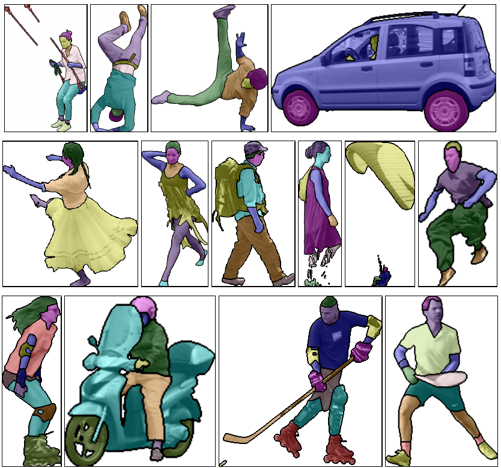

<!-- <a href="papers/STVI/stvi.pdf">[Paper]</a>
<a href="papers/STVI/poster.pdf">[Poster]</a>
<a href="papers/STVI/bib.txt">[BibTex]</a> -->

[Paper]
[Poster]
[BibTex]

**Summary** 
We show how to obtain a scalable representation of objects, which preserves their decomposition into parts. For that we extract features from appearance and motion cues, select the appropriate scale in spatio-temporal scale space and perform clustering.

**Object tracking and decomposition into parts** 
<video controls autoplay loop width="100%">
  <source  src="papers/STVI/girl.mp4" type="video/mp4">
</video> 
Our approach (right) bridges the conceptual gap between low-level video representations such as (left) TSPs  which tend to fall apart over time and do not model objects directly, and instance segmentation methods such as (center) Mask R-CNN  which lack a decomposition into parts, and temporal consistency. Our unsupervised approach is able to detect salient object parts based on motion and appearance.

**Different object sclales** 
<video controls autoplay loop width="100%">
  <source  src="papers/STVI/jumpingjack.mp4" type="video/mp4">
</video> 
Space-Time Volumes of Interest (**STVIs**) extracted at increasing spatial and temporal scales from a jumping-jack sequence. Note how finer scales capture more detail at the cost of temporal and spatial coherence, whereas coarser scales model more fundamental patterns. 

**Viewer/Object-centered representation** 

<video controls autoplay loop height="120">
  <source  src="papers/STVI/rollerblade.mp4" type="video/mp4">
</video> 
The trajectory w.r.t. the observer is shown on the left. The relative motion of object parts w.r.t. the object centroid is shown on the right. This is useful because objects are represented as the sum of their parts, and not just as instance masks. For instance, notice the roller blades that move towards the center of the object axis during the jump.

## Supplement
---

<table class='tiles'>
  <tr>
  <td width="20%" class='teaserimg'> </td>
  <td width="80%">  
    

    

      The DAVIS Parts Dataset
      <!-- <b>Filip Ilic</b>, Axel Pinz -->
      <b>Supplement to WACV 2020 Paper</b>
    

    

    

    <!-- <a href="/DAVISParts.zip">[Download]</a> -->
    [Download]
    

  </td>
</tr>
  
  
</table>

The DAVIS Parts Dataset was created for the purpose of evaluating the decomposition of various objects into their parts and contains 20 annotated videos from the DAVIS2016 challenge, with a total number of 1392 annotated frames. 

Some sample annotations of the dataset are shown below:

<video controls autoplay loop height="120">
  <source  src="papers/STVI/parts/rollerblade.mp4" type="video/mp4">
</video> 
<video controls autoplay loop height="120">
  <source  src="papers/STVI/parts/breakdance-flare.mp4" type="video/mp4">
</video> 
<video controls autoplay loop height="120">
  <source  src="papers/STVI/parts/parkour.mp4" type="video/mp4">
</video> 
<video controls autoplay loop height="120">
  <source  src="papers/STVI/parts/tennis.mp4" type="video/mp4">
</video> 
<video controls autoplay loop height="120">
  <source  src="papers/STVI/parts/train.mp4" type="video/mp4">
</video> 
<video controls autoplay loop height="120">
  <source  src="papers/STVI/parts/paragliding.mp4" type="video/mp4">
</video> 